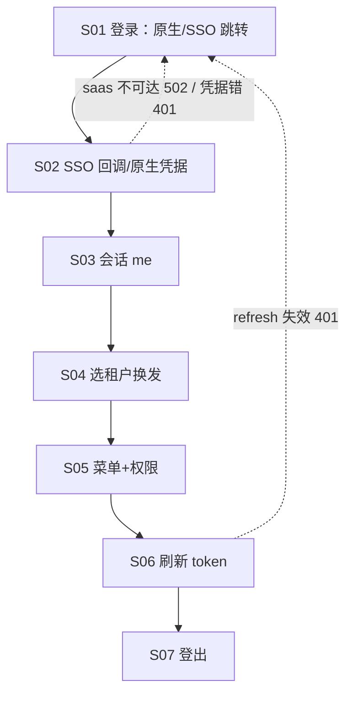

# 流程与功能对齐 — Lab 管理系统 Kotlin/Ktor 端

> 人填、人评审。机器只检查引用的功能 ID 是否存在。
> 评审时把流程图投出来，逐行念「这一步靠哪些功能完成」。念不出来的行，
> 要么流程是空的，要么功能是缺的。这就是对齐的全部意义。

## FLOW-01 认证会话主流程（登录→会话→选租户→菜单/权限）

| 步骤 | 名称 | 角色 | 输入 | 输出 | 状态流转 | 支撑功能子项 |
|---|---|---|---|---|---|---|
| S01 | 登录入口 | 客户端 | 用户名+密码 或 SSO 发起 | authorize 跳转 / native 请求 | state 前端生成待比对 | M01.F05.I02、M01.F05.I06 |
| S02 | 凭据交换 | saas IdP（出站） | code 或账密 | lab JWT（+租户列表） | upsertByEmail 首见建档 | M01.F05.I03、M01.F05.I06 |
| S03 | 会话查询 | 已登录 | Bearer | user+租户列表+currentTenantId | — | M00.F01.I01 |
| S04 | 选租户换发 | 成员 | tenantId | 携 tenant_id claim 的新 token | — | M00.F02.I01 |
| S05 | 菜单+权限 | 成员 | Bearer（tenant 上下文） | 导航树+权限串 | 快照三分支降级 | M01.F04.I01、M01.F04.I02 |
| S06 | 刷新 token | 已登录 | refresh（typ=refresh） | 新 token 对 | rotate-once | M01.F05.I04 |
| S07 | 登出 | 已登录 | Bearer | 200（无状态 JWT，前端清存储） | 会话终止 | M01.F05.I05 |

### 评审时问这四个问题

1. 有没有哪个步骤的「支撑功能子项」是空的？→ 功能缺失，或这一步不该存在
2. 有没有功能子项从头到尾没出现在任何流程里？→ 见下方孤儿清单
3. 状态流转列里的状态名，和代码里的枚举一致吗？→ 不一致就是两套真相
4. 退回路径都画了吗？→ 只画正向流程，会漏掉一半功能

### 孤儿功能

不在任何流程里但合法的功能。**没解释的孤儿 = 没人要的功能。**

| 功能 ID | 为什么合法 |
|---|---|
| — | 无（登出已入 FLOW-01 S07；管理面流程见各仓需求侧说明） |

（原孤儿 M01.F05.I05 已于 2026-10-25 入 FLOW-01 S07。管理面/异常流程单独成表，不列孤儿。）

---

## FLOW-02 认证异常流程

> 异常流程单独成表，否则它承载的功能永远是孤儿。

| 步骤 | 名称 | 触发条件 | 响应 | 支撑功能子项 |
|---|---|---|---|---|
| E01 | saas IdP 不可达 | 出站超时/5xx | 502（镜像语义，不泄露上游细节） | M01.F05.I03、M01.F05.I06 |
| E02 | saas 凭据拒绝 | IdP 返回 401 族 | 401（同语义不透传 saas code） | M01.F05.I06 |
| E03 | refresh 失效/重放 | typ 不符或 rotate-once 重放 | 401 | M01.F05.I04 |
| E04 | 零租户快照 | me 无成员关系 | 空租户列表 + 空 currentTenantId（不 500） | M00.F01.I01 |
